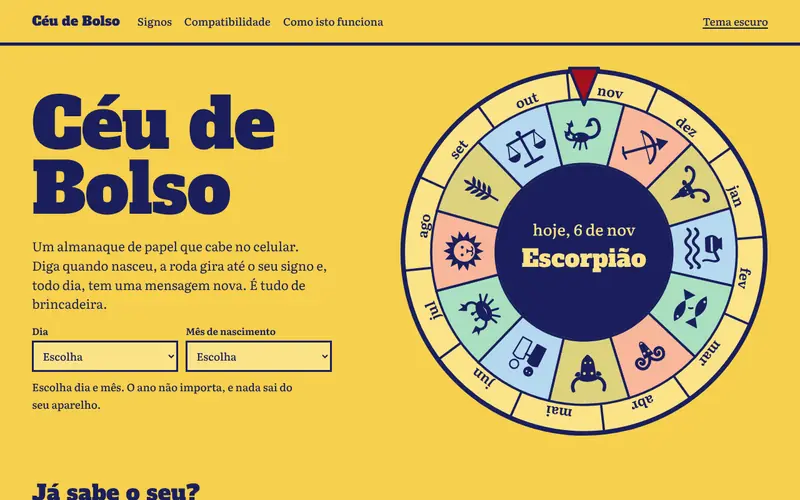

# Céu de Bolso



Fiz este almanaque de bolso interativo, de brincadeira: uma roda de papel que gira até o seu signo, com mensagem nova todo dia, compatibilidade entre signos e cartão para baixar. Começou como página de um trabalho de faculdade e virou uma demonstração de como um site simples pode ser algo que as pessoas usam e voltam a abrir.

Publicado em <https://toshiro01001.github.io/Horoscopo-fasipe/>.

Todo o conteúdo é entretenimento. Os textos foram escritos para este projeto, as mensagens saem de uma conta com a data, e nada aqui serve de orientação médica, financeira ou jurídica. Não há cadastro, nada é vendido nem cobrado.

## Como usar

1. Na página inicial, escolha o dia e o mês em que você nasceu. A roda gira até o seu signo e a mensagem de hoje aparece logo abaixo.
2. Aperte "Abrir folheto" para ver a página do signo, com a mensagem do dia e o cartão. Em "Lembrar como meu signo", o site passa a abrir já no seu signo.
3. No cartão, aperte "Copiar imagem" ou "Baixar imagem" para guardar ou mandar a alguém.
4. Em "Compatibilidade", escolha dois signos e leia, de brincadeira, como a dupla funciona.
5. O botão "Trocar tema" alterna entre claro e escuro.

Quem quiser saber o que roda por trás encontra a explicação na tela "Como isto funciona", que termina com um bloco "Detalhes técnicos" para quem programa, e nas seções abaixo.

## O que ele faz

- Descobre o signo por dia e mês de nascimento e gira a roda até ele.
- Tem uma página para cada um dos 12 signos, com link próprio (`#/signo/leao`).
- Mostra uma mensagem do dia, igual para todos do mesmo signo na mesma data.
- Combina dois signos pelo elemento e pelo modo de cada um.
- Lembra o seu signo e o tema no próprio aparelho.
- Gera um cartão em PNG para copiar ou baixar.
- Tem tema claro e escuro e abre sem internet depois da primeira visita.

## Como funciona (parte técnica)

Não há servidor nem banco de dados: tudo roda no navegador.

| Arquivo | Papel |
| --- | --- |
| `index.html` | Esqueleto da página, metadados de SEO e política de segurança (CSP) |
| `style.css` | Identidade visual; as cores ficam em variáveis no início do arquivo |
| `js/dados.js` | Todo o texto: signos, bancos de frases e combinações |
| `js/logica.js` | Regras puras: signo pela data, mensagem do dia, compatibilidade |
| `js/arte.js` | Os 12 emblemas originais em SVG, usados na página e no cartão |
| `js/cartao.js` | Desenha o cartão no canvas, copia e baixa |
| `js/app.js` | Rotas por hash, roda, favorito e tema |
| `js/tema.js` | Aplica o tema antes de pintar a tela, para não piscar |
| `sw.js` | Service worker: guarda os arquivos e serve sem internet |
| `fonts/` | Alfa Slab One e Literata, hospedadas aqui, com as licenças OFL |

A mensagem do dia junta a data e o signo num texto, transforma esse texto num número (hash FNV-1a) e usa o número para escolher frases nas listas. Por isso é sempre igual para a mesma entrada, sem precisar de servidor.

Ao mudar a lista de arquivos em `sw.js`, troque também o número em `VERSAO`.

## Como rodar

O service worker e a cópia de imagem exigem `localhost` ou HTTPS, então sirva a pasta em vez de abrir o arquivo direto:

```bash
python3 -m http.server 8000
```

Depois abra <http://localhost:8000>.

## Testes

Os testes usam Playwright com Chromium já instalados globalmente e percorrem o site em 1366x800, iPhone 13 e 320 px, na raiz e em subcaminho:

```bash
NODE_PATH=$(npm root -g) node tests/site.test.js
```

Para salvar capturas, defina `CAPTURAS=/caminho/da/pasta` antes do comando.

## Tecnologias

HTML, CSS e JavaScript puros, SVG, Canvas, localStorage, Clipboard API e Service Worker. Sem build, sem CDN e sem serviços de terceiros. Testes com Playwright.

## Licenças

O código está em domínio público (ver `LICENSE`). As fontes seguem a SIL Open Font License, com os textos em `fonts/`.

---

Desenvolvi este projeto e usei o Claude, da Anthropic, como ferramenta durante o desenvolvimento.
